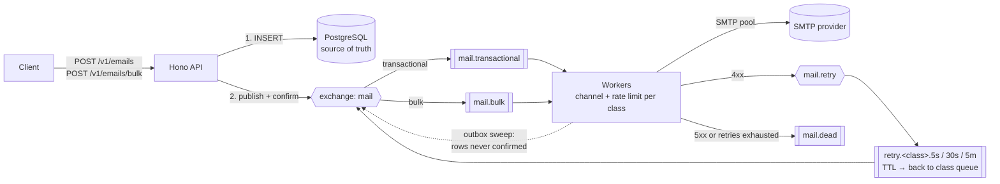

# hono-mail-queue

[](https://github.com/msalimcengiz/hono-mail-queue/actions/workflows/ci.yml)

An email delivery service built with TypeScript, **Hono**, **RabbitMQ** and **PostgreSQL**. Transactional and bulk mail run in separate priority classes, so a 20,000-recipient campaign does not delay a password-reset email. Failed sends are retried after increasing delays and then dead-lettered. A transactional outbox makes sure an email the API accepted reaches the queue even if the broker was down at that moment.


## Try it in 2 minutes

**You need:** Docker with Compose v2, and `make`. Node, the test runner and the demo all run in containers.

```bash
git clone https://github.com/msalimcengiz/hono-mail-queue && cd hono-mail-queue
make demo               # starts the stack and walks through 10 checked steps (below)
make check              # typecheck + lint + 20 unit tests
make test-integration   # 7 end-to-end tests against RabbitMQ, Postgres and Mailpit
make bench              # priority-isolation benchmark
make chaos              # SIGKILL workers, API and RabbitMQ under load; every email checked
make down
```

`make demo` prints each step and fails if something does not behave as described:

1. A password reset goes through RabbitMQ and SMTP. You can see it in Mailpit at http://localhost:8025.
2. The same `Idempotency-Key` returns the original email, and no second copy is sent.
3. A missing template variable is rejected with `422`.
4. A 300-recipient campaign is stored with one `INSERT` and sent.
5. A password reset sent behind a 3,000-email campaign is delivered in milliseconds while the campaign is still queued.
6. A `451` from SMTP is retried after 5 s through a TTL queue and delivered on the second attempt.
7. A `550` is dead-lettered after one attempt.
8. After the cause is fixed, the admin replay endpoint sends the dead letter.
9. With **RabbitMQ stopped**, the API still accepts the email (`202`), because it is stored first.
10. RabbitMQ comes back, and the outbox sweeper publishes the stored email and it is delivered.

To explore by hand: `make up`, then the requests in [`requests.http`](requests.http). Mailpit's chaos switch in that file makes the SMTP server reject mail on demand.

| Port | Service |
|---|---|
| 3000 | API |
| 8025 | Mailpit UI (all sent mail) |
| 15672 | RabbitMQ UI (`mail` / `mail`) |
| 9091 | Prometheus (`docker compose --profile observability up -d`) |



## Results

Run with `make bench`. A 20,000-recipient bulk campaign is queued first. Then 300 password-reset emails arrive at about 30/s while the backlog drains. **10% of SMTP calls fail with a temporary `451`**, injected by Mailpit's chaos mode. Two workers ran with a bulk rate limit of 500/s each, on an Apple M4 in a Colima VM with 4 vCPU and 6 GB, the whole stack in Docker on one machine.

Bulk: 20000, transactional: 300 at ~30/s, SMTP temporary failure rate: 10%.

| class | status | emails | needed a retry | first-try latency p50 | p95 | p99 |
|---|---|---:|---:|---:|---:|---:|
| bulk | failed | 1 | 1 | – | – | – |
| bulk | sent | 19,999 | 1,995 | 8,398 ms | 16,845 ms | 17,615 ms |
| transactional | sent | 300 | 29 | 3 ms | 9 ms | 12 ms |

Bulk first-pass throughput: 943 emails/s (18,004 sent on the first try in 19.1 s). Messages in SMTP sink: 20,299 of 20,300. Total run including the retry ladder (5 s, 30 s, 5 min): 354.1 s.

- **Password resets were sent in 9 ms at p95 while the bulk mail behind them waited about 17 s.** Separate channels and prefetch per class keep them independent.
- The bulk class sent ~940 emails/s on its first pass and stayed under its configured limit (2 workers × 500/s).
- With 10% temporary failures, every email except one was delivered. That email failed all 4 attempts (expected rate 0.1⁴ × 20,000 ≈ 2), so it was dead-lettered and marked `failed`. Retries wait in TTL queues, which do not block the workers.

## Chaos test

Run with `make chaos` ([`bench/chaos.sh`](bench/chaos.sh)). Transactional emails (8 senders with `Idempotency-Key`) and a 500-recipient bulk batch every 5 s are sent for 60 s. During that time:

- A **worker is killed with `SIGKILL` every 4 s** (12 kills in total).
- The **API is killed once** and **RabbitMQ is killed once**.
- **5% of SMTP calls fail with 451.**

| emails accepted | sent | needed a retry | failed | not finished | sent but missing from the SMTP sink | extra copies |
|---:|---:|---:|---:|---:|---:|---:|
| 13,733 | 13,733 | 650 | **0** | **0** | **0** | 0 |

Email is at-least-once by nature. A worker killed after the SMTP server accepted a message, but before the row was marked `sent`, sends it again on redelivery. The run counts such extra copies separately; this run had none.

## Design

| Problem | Solution |
|---|---|
| A large campaign blocks urgent mail | Each class has its own queue, **its own channel and prefetch**, and its own token-bucket rate limit. Bulk backlog cannot take the slots transactional mail needs. |
| SMTP provider rate limits | A token bucket per class and per worker (`RATE_TRANSACTIONAL`, `RATE_BULK`). Total throughput = rate × workers. |
| Temporary failures (`421`, `451`, timeouts) | Retried after **5 s, 30 s, then 5 min** through TTL quorum queues that dead-letter back to the class's work queue. Workers never wait with `setTimeout`. |
| Permanent failures (`5xx`) | Dead-lettered at once to `mail.dead`, with the reason in a header and the row marked `failed`. No retry is wasted. |
| Broker down at accept time | The row is committed first, then published with **publisher confirms**. The API's broker connection reconnects in the background, so the API keeps serving while RabbitMQ is down. If publishing fails or is not confirmed within 5 s, the API still returns `202`. A sweeper in the workers republishes rows that have no `enqueued_at`, using `FOR UPDATE SKIP LOCKED` so several workers can run it safely. |
| Duplicate deliveries | `claim()` is a conditional `UPDATE … WHERE status IN (...)`. Redeliveries and duplicate messages are acknowledged and skipped. |
| Client retries | An `Idempotency-Key` header (unique column) returns the original email with `200`. |
| Worker crash mid-send | The unacknowledged message is redelivered with `redelivered=true`, which allows reclaiming a row stuck in `sending`. Delivery is at-least-once, the normal guarantee for email. |
| Header injection / XSS in templates | Variables are HTML-escaped in bodies. Newlines are stripped from subjects. |
| Lost messages on deploy | `SIGTERM` cancels the consumers, waits for in-flight sends, then closes. Queues are durable quorum queues and messages are persistent. |
| Redelivery limit | RabbitMQ 4 gives quorum queues a default limit of 20 deliveries and, **without a dead-letter exchange, silently drops** the message when it is reached. The work queues set `x-delivery-limit` together with a DLX, so the message becomes an inspectable dead letter instead. |
| Database down while consuming | The handler waits with exponential backoff and jitter **before** `nack`ing. An immediate requeue would spin through the delivery limit in milliseconds. |
| Replaying dead letters | `POST /admin/dlq/replay?limit=N` (admin token). It resets failed emails and republishes them. Only the messages present when the call starts are processed, so a message that fails again waits for the next replay instead of looping. The email's `enqueued_at` is cleared first, so if the replay publish fails, the outbox sweeper sends it. |

## Run it

Only Docker is required.

```bash
make up                 # API :3000 · RabbitMQ UI :15672 (mail/mail) · Mailpit UI :8025
curl -XPOST localhost:3000/v1/emails -H 'content-type: application/json' \
  -H 'Idempotency-Key: order-1001' \
  -d '{"template":"password_reset","to":"ali@example.com","vars":{"name":"Ali","reset_url":"https://x"}}'
make check              # typecheck + biome + 20 unit tests
make test-integration   # 7 end-to-end tests against the real stack (SMTP chaos included)
make bench              # the benchmark above
./bench/chaos.sh        # the chaos run above
make k8s-validate
```

### API

| Endpoint | |
|---|---|
| `POST /v1/emails` | `{template, to, vars, idempotency_key?}` returns `202 {id}`. A repeated key returns `200 {id, duplicate: true}`. |
| `POST /v1/emails/bulk` | `{template, shared_vars, recipients: [{to, vars}]}` with up to 1,000 recipients. One `INSERT … SELECT unnest(...)`. Returns `202 {batch_id, count}`. |
| `GET /v1/emails/:id` | Status, attempts and last error |
| `GET /v1/batches/:id` | Counts per status |
| `GET /healthz`, `/readyz`, `/metrics` | |

Validation errors return `422` with field errors, or with the `index` of the recipient that is missing template variables.

## Tests

- **Unit (20):** retry policy, template escaping and header-injection guard, token bucket timing, consumer outcomes (sent / retry / dead / duplicate, publish-before-update ordering), and the API (validation, idempotency, bulk, broker-down path).
- **End-to-end (7):** run against real RabbitMQ, Postgres and Mailpit. Mailpit's chaos mode injects `451` and `550` replies:
  - Transactional delivery and idempotency
  - A 200-recipient batch
  - Temporary failure, then a successful retry after 5 s (`attempts = 2`)
  - Permanent failure, dead-lettered after 1 attempt
  - Outbox recovery of a row that was never published
  - A dead-lettered email is replayed after the cause is fixed (admin token required)

## Metrics

`mail_enqueued_total`, `mail_sent_total`, `mail_retries_total{delay}`, `mail_failed_total{reason}`, `mail_duplicate_deliveries_total`, `mail_outbox_republished_total`, `mail_smtp_send_duration_seconds`, `mail_end_to_end_seconds`, `mail_queue_depth`. Run `docker compose --profile observability up -d` to start Prometheus on `:9091`.

## Layout

```
src/api.ts          Hono routes, zod validation, outbox-safe enqueue
src/broker.ts       topology (exchanges, quorum queues, TTL retry queues), confirm-channel publishing
src/consumer.ts     one delivery: claim → throttle → send → sent | retry | dead
src/worker.ts       per-class channels, prefetch, rate limits, outbox sweeper, graceful drain
src/db.ts           repository: idempotent insert, bulk unnest insert, claim, outbox lock
src/retry.ts        retry ladder and SMTP error classification
src/ratelimit.ts    token bucket
src/templates.ts    templates, escaping, required variables
deploy/k8s          kustomize: API (HPA) and workers
```

## License

MIT
